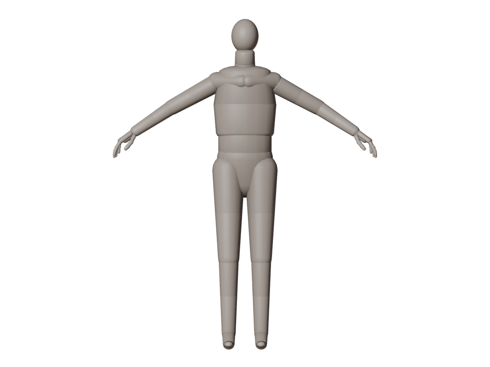
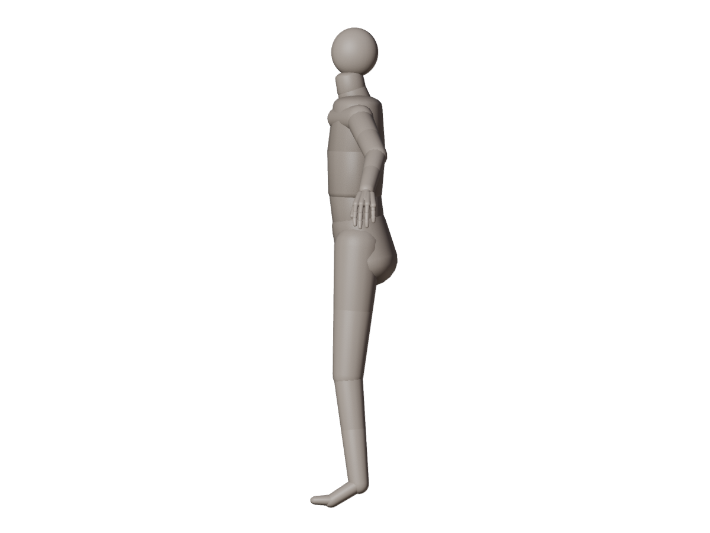
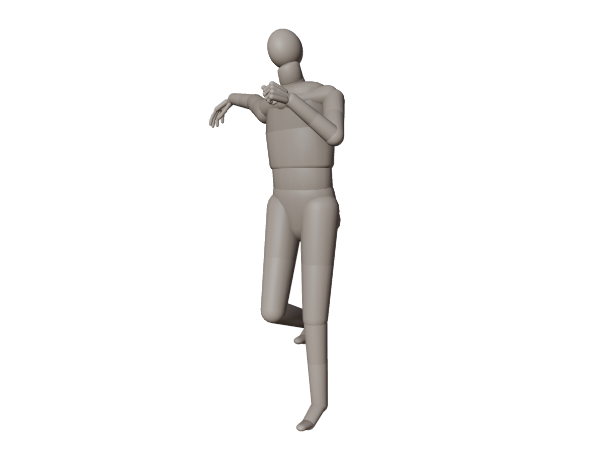
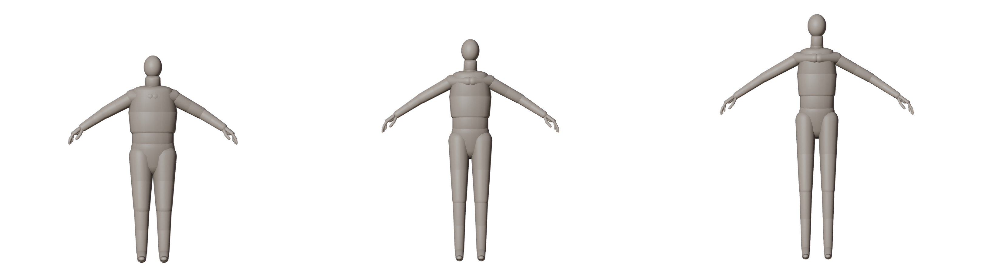
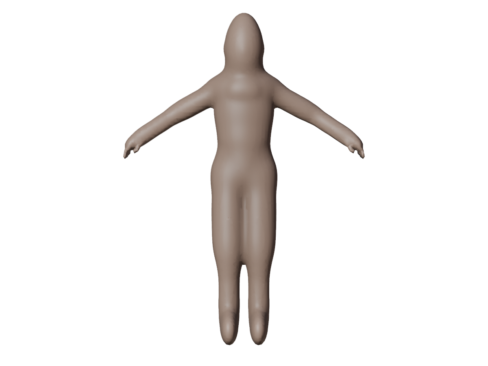

# Blender-men

いろいろな人間キャラクターを作るための **ベース人体（骨組み）** です。
Blender 標準アドオン **Rigify** の Human メタリグをテンプレートにして、
プロポーションをパラメータで変えられるようにしています。

| 正面 | 側面 | 関節を動かした例 |
| --- | --- | --- |
|  |  |  |

パラメータを変えた派生例（左から `example_short_stocky` / `base` / `example_tall_slim`、同じ縮尺）:



## 中身

`models/base_human.blend`（Blender 5.2 で作成）の `BaseHuman` コレクション:

| オブジェクト | 役割 |
| --- | --- |
| `BH_metarig` | 体型の設計図（Rigify メタリグ、非表示）。キャラごとの骨格はここを編集して作り直す |
| `BH_rig` | Rigify で生成したコントロールリグ。**関節を動かすのはこれ** |
| `BH_body` | 骨格確認用の簡易マネキン。各 `DEF-` ボーンに 100% ウェイトで追従する |

- 身長 1.70m（頭頂 = `spine.006` の先端）、足裏が Z=0、正面は -Y 方向、A ポーズ
- 骨は顔（目・まぶた・口・あご・耳など）と指（5本×3関節）まで含む
- アニメーションはまだ付けていない（レストポーズのまま）

## 関節の動かし方

`BH_rig` を選んで **Pose モード** に入ると、各関節のコントローラを回したり動かしたりできます。

| 部位 | 主なコントローラ |
| --- | --- |
| 全体 / 胴 | `root`, `torso`, `hips`, `chest` |
| 首・頭 | `neck`, `head` |
| 腕（FK） | `shoulder.L/R`, `upper_arm_fk.L/R`, `forearm_fk.L/R`, `hand_fk.L/R` |
| 腕（IK） | `hand_ik.L/R`（手の位置を動かすと肘が自動で曲がる） |
| 脚（FK） | `thigh_fk.L/R`, `shin_fk.L/R`, `foot_fk.L/R`, `toe_fk.L/R` |
| 脚（IK） | `foot_ik.L/R`, `foot_heel_ik.L/R`, `toe_ik.L/R` |
| 指 | `f_index/f_middle/f_ring/f_pinky.01〜03.L/R`, `thumb.01〜03.L/R`, 握りは `*_master` |
| 顔 | `jaw_master`, `eyes`, `lid.*`, `brow.*`, `lip.*` など |

- 腕と脚は初期状態が **IK**。`upper_arm_parent.L` / `thigh_parent.L`（R も同様）のカスタムプロパティ
  `IK_FK` を 1.0 にすると FK に切り替わります（0 = IK, 1 = FK）
- Blender でファイルを開くときに **「Python スクリプトの自動実行を許可」** すると、
  サイドバー（N パネル）の Item タブに Rigify の IK/FK 切り替えボタンなどの UI が出ます
  （スクリプトを許可しなくても関節は動かせます）

## 別の人間を作る

### 方法 1: プリセット JSON で体型を変えて生成する

`presets/base.json` をコピーして値を変え、スクリプトを実行します。

```json
{
  "name": "my_character",
  "height": 1.62,
  "leg_length": 1.05,
  "torso_length": 1.0,
  "arm_length": 1.0,
  "shoulder_width": 0.92,
  "hip_width": 1.05,
  "head_scale": 1.05,
  "girth": 0.95
}
```

| パラメータ | 意味 |
| --- | --- |
| `height` | 身長 [m]（頭頂まで） |
| `leg_length` | 太もも + すねの長さ倍率 |
| `torso_length` | 胴（骨盤〜首の付け根）の長さ倍率 |
| `arm_length` | 上腕 + 前腕の長さ倍率 |
| `shoulder_width` | 肩幅倍率 |
| `hip_width` | 股関節の幅倍率 |
| `head_scale` | 頭（顔ボーン含む）の大きさ倍率 |
| `girth` | マネキンの太さ倍率（骨格には影響しない） |

倍率は先に適用し、最後に `height` に合わせて全体を拡縮します。
そのため `leg_length` を上げても身長は変わらず、「同じ身長で脚が長い人」になります。

```bash
# Blender 本体で実行
blender -b -P scripts/build_base_human.py -- --preset presets/my_character.json --preview previews/my_character.png

# pip の bpy モジュールで実行（pip install bpy、Python 3.13）
python scripts/build_base_human.py --preset presets/my_character.json
```

`models/<name>_human.blend` が出力されます。`--output` で保存先、`--preview` で正面・側面の画像、
`--no-rig` でメタリグだけを生成できます。

### 方法 2: Blender 上でメタリグを直接編集する

1. `BH_metarig` を表示して Edit モードで骨の位置を調整する
2. Armature プロパティの Rigify パネルで **Generate Rig**（`BH_rig` が作り直される）
3. 自作の体メッシュを `BH_rig` に Armature 変形で親子付けする（Ctrl+P → With Automatic Weights）。
   ウェイトを付けるのは `DEF-` で始まる骨です

`BH_body` は骨格確認用の簡易メッシュです。より滑らかな形状を生成する場合は、下の `organic` モードを使えます。

## 連続した人体メッシュ（開発中）

`scripts/build_base_human.py` の `organic` モードは、Rigify の骨の位置から楕円体を生成し、Blender のメタボールで融合して一つの連続した表面にします。顔の目・鼻・耳の基礎形状、手指、足も追加し、生成後に自動ウェイトでリグへ結びつけます。このメッシュとプレビューは外部人体モデルを使わずに生成しています。



```bash
blender -b -P scripts/build_base_human.py -- --preset presets/base.json \
  --body organic --output models/body_from_skeleton.blend \
  --preview previews/body_from_skeleton.png
```

`--body capsule` は従来の骨ごとのマネキンを生成します。`organic` は滑らかなベース形状の試作段階で、解剖学的な筋肉・顔の造形やウェイト調整は今後の作業です。

## 関節の確認

```bash
python scripts/render_pose_test.py --blend models/base_human.blend --out previews/pose_test.png
```

首・胸・左腕（FK）・左手の指・右手（IK）・右脚（IK）を曲げた画像を描画し、
マネキンの頂点が実際に動いたかを出力します（`.blend` は変更しません）。

## 構成

```
models/base_human.blend        ベース人体
presets/base.json              標準体型のパラメータ
presets/example_*.json         派生体型の例
scripts/build_base_human.py    メタリグ調整 → リグ生成 → マネキン作成 → 保存
scripts/render_pose_test.py    関節を曲げた確認画像を描画
previews/                      プレビュー画像
```
