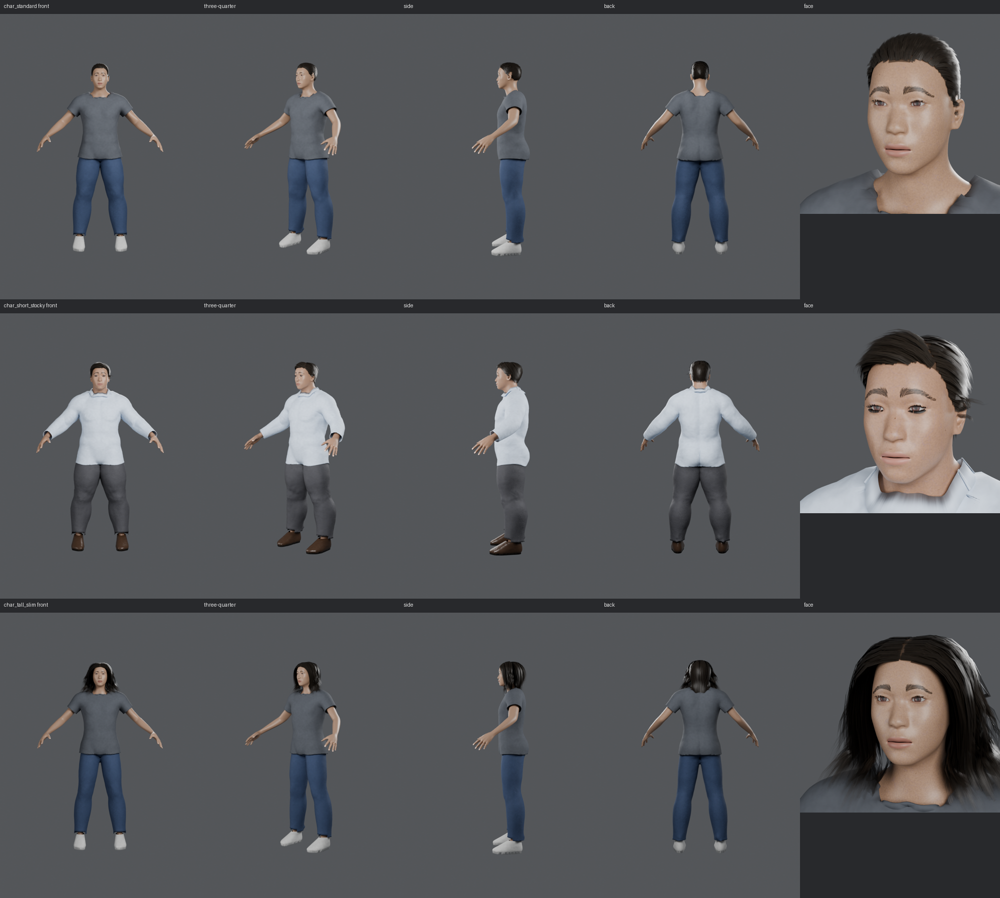

# hq — 高品質キャラクター生成基盤（MPFB2 ベース）

既存のカプセル体（`scripts/`）とは別系統の、本番用の生成経路です。
高品質な人体マスターと再利用できる髪・服の素材を一度作り、個々の人物は
**入力 JSON（体型パラメータと素材の選択）だけ**で組み立てます。
出力は Blender ファイル・ゲーム用 GLB・確認画像・検査結果です。



## 1. 技術の比較と採用理由

### 人体

| 方式 | 体・顔の品質 | 体型変更時の破綻 | 判定 |
| --- | --- | --- | --- |
| カプセル体（`claude/human-axis-prep`） | マネキン | なし（形が単純） | 量産の主経路にしない |
| Skin モディファイア体（`claude/lucid-hawking-mlvo9u`） | 粘土状 | なし | 不採用 |
| 骨格から生成した有機体（`codex/body-from-skeleton`） | 顔・手が塊 | なし | 不採用 |
| **MPFB2（MakeHuman）** | **自然な顔・手・足** | **シェイプキーで連続変形** | **採用** |

以前 MakeHuman の基本メッシュが「ドレス」「髪の板」に見えたのは、服・髪を合わせるための補助形状
（`helper-*`）を体と一緒に描画していたためで、MPFB2 はこれを MASK モディファイアで正しく隠します。

### 骨格（ゲーム共通骨格）

同じ体で 3 方式を計測（`/tmp` の計測スクリプト、MPFB2 commit `6ff1eb3`）。

| 方式 | 生成時間 | 骨（うち変形用） | ウェイト | 判定 |
| --- | --- | --- | --- | --- |
| **MPFB `game_engine`** | **0.21 秒** | **53（53）** | **MakeHuman 付属** | **採用（Unreal 系の命名）** |
| MPFB 経由の Rigify | 1.03 秒 | 930（181） | MakeHuman 付属 | Blender でのアニメ制作用の選択肢 |
| 既存 BH_rig 方式（Rigify＋自動ウェイト） | 15.9 秒 | 706（160） | 熱拡散。240 頂点が未割り当て | 不採用（関節の合わせ込みも別途必要） |

ゲーム骨格は 53 本・全骨が変形用で、glTF にそのまま出せます。1 頂点あたりの骨の影響は 4 本に制限し、
Blender 上と GLB 上の変形が一致するようにしています（往復誤差 0.001 mm）。

### 髪・服の素材

MakeHuman の髪・服アセットの配布元（makehumancommunity.org）はこの環境のネットワークポリシーで
拒否されるため、髪と服はこのリポジトリで生成し、**MPFB の .mhclo 素材**として書き出しています。
.mhclo は素材の各頂点を体の三角形へ結びつける形式で、別の体型には MPFB が再フィットし、
骨のウェイトも体から移ります。服の下に完全に隠れる体の頂点は「Delete グループ」として素材に記録され、
動いても肌が服を突き抜けないよう読み込み時に隠されます。

| 素材 | 作り方 |
| --- | --- |
| 髪 3 種（crew / side_part / long） | 目・眉・頭頂から決めた生え際に根元を置き、髪型ごとの流れ・重力・頭との衝突で毛束を伸ばし、半透明の毛束テクスチャを貼ったカード（帯）にする。頭皮に髪色の下地を塗る |
| 服 2 着（casual: Tシャツ・ジーンズ・スニーカー / business: ワイシャツ・スラックス・革靴） | 平滑化した体の下地から型紙を取り、実際の体から一定の距離（ゆとり）まで押し出し、軽い布シミュレーション（自己衝突あり）で垂れを付ける。平面で裾・袖口を切り、厚みと襟を付け、布の質感を色・法線マップへ焼き込む。靴は足の凸包から作る |

人体のアセット（基本メッシュ・targets・リグ・ウェイト・目）は CC0（MPFB2 / MakeHuman）。
生成した髪・服・テクスチャも CC0 として `assets/index.json` に記録しています。
MPFB2 のコードは GPLv3 なのでリポジトリには含めず、固定コミットを取得して使います（`mpfb_env.py`）。

## 2. 使い方

### 準備

```bash
pip install bpy==5.2.3 pillow   # Python 3.13
# 初回実行時に MPFB2（固定コミット）と MakeHuman の目のプロキシを .cache/ に取得して導入する
```

### キャラクターを作る（入力 JSON だけ）

```bash
python hq/generate.py --config hq/config/char_standard.json --out-dir out/char_standard
```

出力: `<name>.blend`、`<name>.glb`、`render/`（正面・斜め・側面・背面・顔）、`motion/`（パンチ・キック・しゃがみ。
Blender 版と GLB 再読み込み版）、`checks.json`、`motion.json`、`state.json`、`report.json`。

設定ファイルの例（`hq/config/char_short_stocky.json` より抜粋）:

```json
{
  "name": "char_short_stocky",
  "macros": {"gender": 1.0, "age": 0.62, "muscle": 0.85, "weight": 0.78, "height": 0.18, "proportions": 0.4,
             "asian": 0.6, "caucasian": 0.3, "african": 0.1},
  "rig": "game_engine",
  "skin": {"color": [0.45, 0.27, 0.18], "roughness": 0.45},
  "hair": "side_part",
  "outfit": "business"
}
```

`macros` は MPFB の体型パラメータ（0〜1）、`targets` に MPFB の個別 target（顔の部位など）も指定できます。

### 段階と自動検査

| 段階 | 内容 | 検査 |
| --- | --- | --- |
| build | 体型 → 骨格 → 肌 → 目 → 眉・まつげ → 髪 → 服 → 4 本制限 → 焼き込み | — |
| checks | `hq/checks.py` | 骨 53 本・身長の範囲、全頂点に骨のウェイト・4 本以内・合計 1、髪が頭・首・胸の骨だけに結ばれ頭に埋まっていない、目の左右対称、まつげの有無、服の下の体を隠す設定、休止姿勢での肌の突き出し、glTF で書き出せるマテリアル |
| render | `hq/render_views.py` | 目視確認用の 5 方向 |
| validate | `hq/validate_motion.py` | パンチ・キック・しゃがみでの辺の伸縮（破綻）、目が頭に追従、服の上に肌が突き出す割合（3% 以下）、GLB 書き出し → 再読み込みで全メッシュの頂点が一致（5 mm 以下） |

`state.json` に段階ごとの入力ハッシュ・成否・所要時間・失敗の原因・対処（remedy）を記録します。
再実行すると、入力が変わらず成功済みの段階は飛ばし、失敗した段階とそれ以降だけをやり直します
（すべて成功済みなら 0.07 秒で終わる）。服・髪の検査で失敗した場合は、その素材だけを作り直す
コマンドが remedy に入ります。

### 素材を作り直す

```bash
python hq/author_assets.py                 # 全素材（約 12 分）
python hq/author_assets.py --only tshirt   # 指定した素材だけ
```

素材づくりでは、服の開口部（首・裾・袖口など）の数を数え、期待値と違う（穴や裂けがある）服は
素材として登録せず、原因を `assets/index.json` に記録します。

## 3. 検証結果

（生成時間と失敗率は下の節を参照）

| キャラクター | 身長 | 破綻した辺 | 肌の突き出し（最大） | GLB 往復誤差 | GLB |
| --- | --- | --- | --- | --- | --- |
| master（七三分け・普段着） | 1.66 m | 0.19% | 1.7% | 0.004 mm | 7.9 MB |

画像: `output/master/render/`、`output/master/motion/`、`output/<キャラクター>/`、
`output/three_characters_views.png`、`output/three_characters_motion.png`

## 4. 既知の限界

- 写実度は「自然なゲームキャラクター」の水準で、写真のような肌・髪ではない。
- 服の細かいしわは少ない（形状は意図的に滑らかにし、質感は焼き込んだ法線マップで表現）。
  Tシャツの首回りはやや波打つ。
- 髪はカード方式。近づくとカードの縁が見える。長い髪は揺れ用の骨がない（頭・首・胸に固定）。
- 表情（シェイプキー）は未設定。
- 焼き込み（4K の色と法線）が生成時間の大半（約 3.5 分）を占める。
